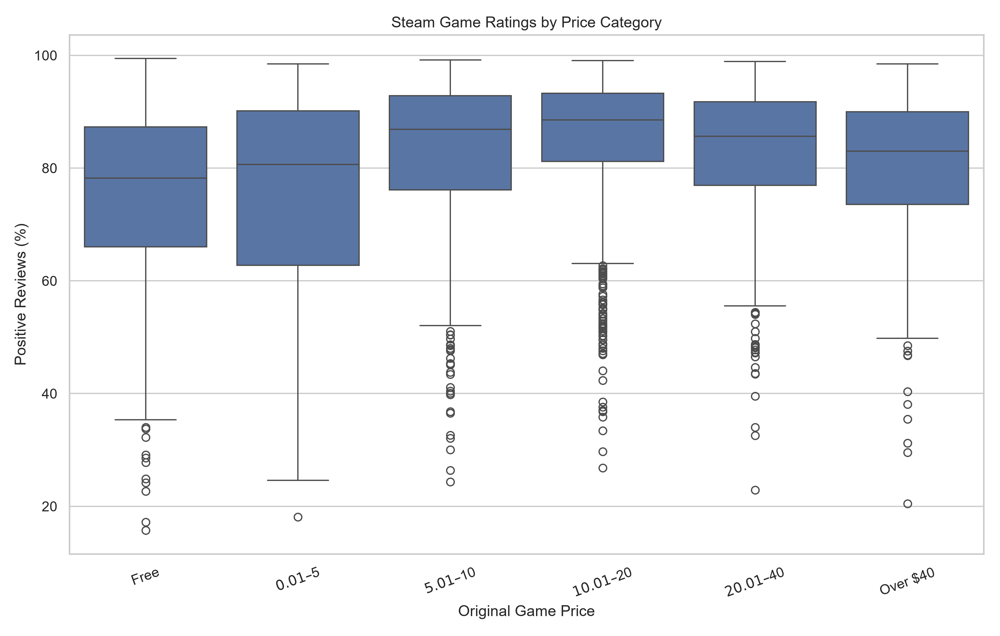
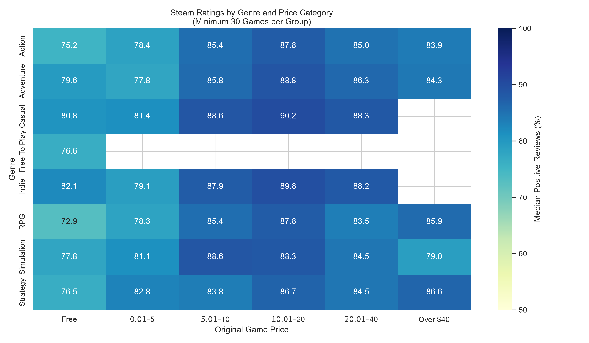
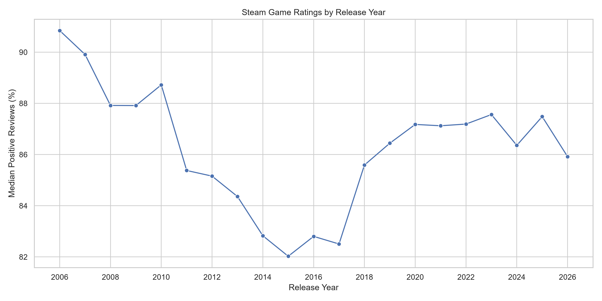

# Are Expensive Steam Games Actually Better?

### An Analysis of Game Prices, Genres, Release Dates, and Player Ratings

This project investigates whether more expensive video games on Steam receive better player ratings. Using Python, I collected game information from the Steam Spy API, enriched it with release dates from The Game Census, and analyzed relationships between prices, community ratings, genres, tags, publishers, and release years.

The project was developed for **STAT 386: Data Acquisition and Management at Brigham Young University (Fall 2026)**.

## Research Questions

- Do higher-priced Steam games receive better player ratings?
- Which price categories tend to receive the highest ratings?
- How do ratings differ across genres and community tags?
- Are there differences in ratings across publishers and release years?
- Do the findings change when games with relatively few reviews are excluded?

## Data Sources

**1. Steam Spy API**

https://steamspy.com/api.php

Steam Spy provides game metadata and estimated Steam statistics, including:

- Steam App ID and game title
- Developer and publisher
- Current and original listed price
- Positive and negative review counts
- Game genres and community tags
- Estimated ownership ranges

The collection script retrieves game lists and detailed metadata using API requests, with local JSON caching, delays, and retry handling.

**2. The Game Census**

https://thegamecensus.com/data

The Game Census provides additional game metadata, including release dates. Its downloaded index is matched to Steam Spy records using Steam App IDs.

The Game Census data is available under a Creative Commons Attribution 4.0 license. See the source website for attribution and licensing details.

## Dataset Overview

The initial Steam Spy dataset contained **4,996 games**. After cleaning and filtering, the final dataset contained:

| Dataset | Records | Description |
|---|---:|---|
| Games | 4,855 | One row per game |
| Genres | 13,478 | One row per game–genre relationship |
| Tags | 87,408 | One row per game–community-tag relationship |
| Publishers | 5,389 | One row per game–publisher relationship |

Release dates were available for **4,358 cleaned games**, approximately **89.8%** of the final sample.

Each game includes engineered variables such as:

- `total_reviews`: Sum of positive and negative review counts
- `positive_pct`: Percentage of reviews classified as positive
- `price_usd`: Current listed price converted to dollars
- `original_price_usd`: Original listed price converted to dollars
- `price_category`: Price bracket based on original listed price
- `genre_count`: Number of genres associated with the game
- `tag_count`: Number of returned community tags
- `release_year`: Year of release, when available

## Data Cleaning and Processing

The data-processing pipeline:

1. Loads previously collected Steam Spy data from a local CSV.
2. Joins release dates using Steam App IDs.
3. Converts numeric fields into appropriate types.
4. Removes duplicate game IDs and records with missing required values.
5. Excludes games with fewer than 50 recorded reviews.
6. Calculates review percentages and dollar-denominated prices.
7. Separates multi-valued genres, community tags, and publisher labels into relational tables.
8. Validates identifiers, ratings, prices, and duplicate relationships.
9. Exports cleaned datasets for analysis.

Publisher splitting uses a heuristic designed to preserve corporate suffixes such as `Inc.` and `Ltd.`. The original publisher labels are also retained.

## Key Findings

### Price and Player Ratings

For paid games with at least 50 reviews, the overall relationship between original listed price and positive-review percentage was very weak:

- Pearson correlation: **0.021**
- Spearman correlation: **0.032**

Games priced between **$10.01 and $20** had the highest average positive-review percentage in the full cleaned dataset, approximately **85.59%**.



### Results Depend on Review Thresholds

When restricting the analysis to paid games with at least 2,000 reviews, the Pearson correlation changed to approximately **−0.196**.

This indicates that the price–rating relationship is sensitive to which games are included. These associations should not be interpreted as evidence that price causes changes in player satisfaction.

### Genre Differences

Game ratings varied across genres. Because games can belong to multiple genres, genre groups are not mutually exclusive.

The following visualization compares median ratings across genres and price categories. Combinations containing fewer than 30 games are excluded from the heatmap.



### Community Tags

Games carrying certain community tags had notably different review percentages.

For example, games tagged `Visual Novel` had a median positive-review percentage of approximately **92.44%**, while games tagged `MMORPG` had a median of approximately **70.12%** among tags appearing on at least 100 games.

These are descriptive associations, and games frequently have overlapping tags.

### Release Years

Release-year comparisons showed differences in median positive-review percentages across release cohorts. However, the review percentages represent cumulative ratings, not ratings recorded during each release year.



## Project Structure

```text
steam-game-analysis/
├── data/                    # Local datasets and cached API responses
├── figures/                 # Saved analysis visualizations
├── src/
│   ├── collect_data.py          # Steam Spy API collection
│   ├── collect_release_dates.py # Release-date enrichment
│   ├── analysis_utils.py        # Genre, tag, and publisher helpers
│   ├── data_processing.py       # Cleaning and normalization
│   ├── eda.py                   # Exploratory analysis and summaries
│   ├── visualizations.py        # Figure generation
│   ├── main.py                  # Offline analysis entry point
│   └── check_reproducibility.py # Output file hashing
├── .gitignore
├── .python-version
├── pyproject.toml
├── uv.lock
└── README.md
```

## Installation and Reproduction

### Requirements

- Python compatible with the project's `pyproject.toml`
- [uv](https://docs.astral.sh/uv/), a Python package and project manager
- Internet access for the initial data-acquisition scripts

### 1. Clone the repository

```bash
git clone https://github.com/DarthVenatus22521/Steam-Scraping-Tutorial.git
cd steam-game-analysis
```

Replace the placeholder URL with this repository's actual GitHub address.

### 2. Install dependencies

```bash
uv sync
```

This installs the dependencies defined by `pyproject.toml` and `uv.lock`.

### 3. Collect Steam Spy data

```bash
uv run python src/collect_data.py
```

This script makes network requests and stores cached responses locally. Collection may take substantial time because it uses request delays and API rate limiting.

### 4. Collect release dates

```bash
uv run python src/collect_release_dates.py
```

This downloads the release-date source, caches it, and creates a local lookup table.

### 5. Run the offline analysis

```bash
uv run python src/main.py
```

This script does not make API calls. It reads locally collected data, performs cleaning and analysis, and saves CSV outputs and figures.

**Note:** Generated datasets and API caches are excluded from Git. On a fresh clone, the acquisition scripts must be run before the offline analysis.

## Outputs

The analysis creates:

**Cleaned datasets in `data/`:**

- `steam_games.csv`
- `steam_genres.csv`
- `steam_tags.csv`
- `steam_publishers.csv`

**Analysis summaries in `data/analysis/`:**

- `price_summary.csv`
- `genre_price_summary.csv`
- `tag_summary.csv`
- `publisher_summary.csv`
- `sensitivity_summary.csv`
- `sensitivity_price_summary.csv`
- `release_year_summary.csv`

**Figures in `figures/`:**

- `price_vs_rating.png`
- `ratings_by_price_category.png`
- `ratings_by_genre.png`
- `genre_price_heatmap.png`
- `most_common_tags.png`
- `ratings_by_release_year.png`

Figures are saved automatically without opening interactive plotting windows.

## Reproducibility

A separate script computes SHA-256 hashes of the generated CSV files:

```bash
uv run python src/check_reproducibility.py
```

The offline analysis was executed repeatedly with unchanged inputs, and the generated CSV files produced identical hashes.

## Limitations and Ethical Considerations

This project has several limitations:

- **Selection bias:** The sample comes from Steam Spy's popularity-oriented listings and is not a random sample of all Steam games.
- **Review counts:** Positive-review percentages are an imperfect measure of game quality and may reflect player expectations, community behavior, and other factors.
- **Price measurement:** Original listed price is not necessarily the price paid by reviewers. The zero-price category is based on a recorded original price of zero and does not necessarily identify every genuinely free-to-play game.
- **Missing dates:** Release dates were unavailable for approximately 10.2% of the cleaned games.
- **Overlapping categories:** Games may belong to multiple genres, tags, and publisher groups.
- **Limited tag coverage:** Steam Spy returns a limited number of community tags per game.
- **Observational analysis:** Correlations and group differences do not establish causal relationships.

API requests were separated from the offline analysis and implemented with local caching, retry handling, and delays to reduce unnecessary requests.

Raw API responses and generated datasets are not included in this repository. The project instead provides the collection and processing scripts so the data can be obtained from its original sources, subject to their applicable terms.

## Conclusion

The results suggest that **higher-priced Steam games are not consistently better rated**. Although mid-priced games performed well in the full cleaned sample, the patterns changed when review-count thresholds were adjusted.

Game genres, community tags, publishers, and release cohorts also showed meaningful descriptive differences. Taken together, the results demonstrate why game price alone is not a reliable indicator of player satisfaction.

## Author

Spencer Hales 
Brigham Young University  
Fall 2026
